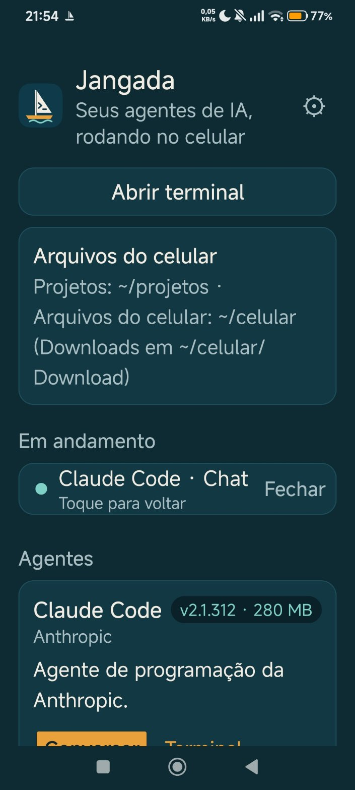
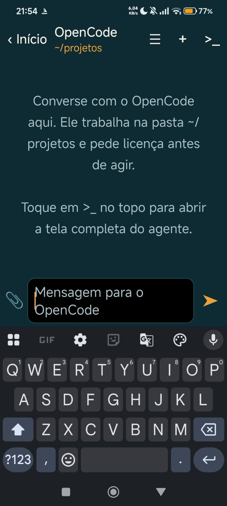
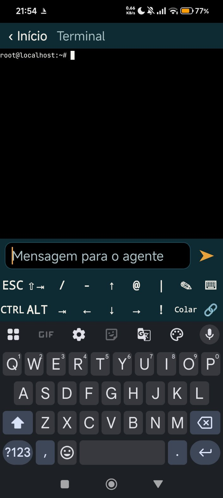
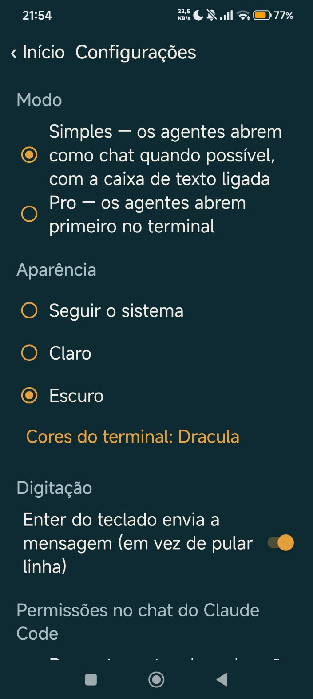

  
  
  
  

# Jangada

**Agentes de IA de linha de comando no seu Android — Claude Code, Codex, OpenCode, Qwen Code e outros. Sem root, sem computador, sem servidor.**

*[English below](#english)*

O Jangada traz um Linux Debian completo para dentro do app e deixa você instalar, abrir e conversar com os principais agentes de IA de programação com um toque. Dá para usar como um chat, com corretor e ditado por voz, ou na tela completa de terminal de cada agente.

## Recursos

- **Catálogo de agentes**: Claude Code, Antigravity CLI (agy), Codex, OpenCode, Pi, oh-my-pi, Qwen Code, Hermes Agent, Command Code e OpenClaw. Instalar, atualizar (quando há versão nova ou, sem fonte de versão, a cada 7 dias) e desinstalar com um toque, mostrando o espaço que cada um ocupa.
- **Chat**: balões com respostas em tempo real, ações do agente, cartões de permissão (permitir, recusar ou permitir sempre), plano de tarefas, tabelas e blocos de código com botão copiar. Troca de modelo, esforço e modo pelo próprio chat. Funciona com o Claude Code e com os agentes que falam o [Agent Client Protocol](https://agentclientprotocol.com).
- **Chat ⇄ Terminal**: no Claude Code, a mesma conversa nos dois modos.
- **Login guiado**: na primeira vez, o app mostra como entrar na conta de cada agente: pelo navegador quando o agente oferece, ou pela tela do próprio agente.
- **Anexos**: mande fotos, prints e arquivos para o agente.
- **Terminal de verdade**: abas, teclas extras pensadas para agentes, caixa de texto com corretor e voz, links clicáveis, fontes com os símbolos que os agentes usam e esquemas de cores.
- **Segundo plano**: os agentes continuam trabalhando com a tela apagada ou em outro app.
- **Arquivos do celular**: os agentes leem e salvam em `~/celular` (Downloads, Documentos…); os projetos ficam em `~/projetos`.
- **Modo Simples e Modo Pro**: no Simples, os agentes abrem no chat (quando têm um) e a caixa de texto já vem ligada. No Pro, eles abrem primeiro no terminal e as abas ficam sempre visíveis.
- **Tema** claro, escuro ou do sistema.
- **Chaves de API** guardadas com criptografia (Android Keystore), para quem usa os agentes com chave.
- **Backup** dos projetos e das configurações dos agentes, e **Liberar espaço** com um toque.
- **Sem anúncios e sem rastreamento.** O Jangada só acessa a internet para instalar o Linux e os agentes e para ver se há versões novas; suas conversas vão só para os serviços de IA que você escolher.

## Instalar

1. Baixe o `Jangada.apk` na página de [Releases](https://github.com/JonJonesBR/jangada/releases/latest) e instale (o Android vai pedir permissão para instalar apps desta origem).
2. Abra o app e toque em **Instalar agora**: o Linux é preparado uma única vez (cerca de 70 MB de download).
3. Escolha um agente no catálogo, toque em **Instalar** e depois em **Conversar**.

**Atualizações automáticas:** use o [Obtainium](https://github.com/ImranR98/Obtainium) e adicione o endereço `https://github.com/JonJonesBR/jangada`.

**Requisitos:** Android 8 ou mais novo, processador ARM de 64 bits e cerca de 700 MB livres (mais o espaço dos agentes que você instalar). Cada agente usa a sua própria conta ou chave de API no serviço de IA correspondente.

## Como funciona

O Jangada usa o motor de terminal do [Termux](https://github.com/termux/termux-app) e roda um Debian oficial dentro do app com [proot](https://github.com/termux/proot), sem precisar de root. Os agentes são instalados com os instaladores oficiais de cada projeto. O chat conversa com os agentes pelos protocolos que eles mesmos oferecem para integração com editores.

O app é distribuído pelo GitHub, e não pela Play Store: para executar o Linux dentro do app, ele usa `targetSdk 28`, a mesma escolha do Termux.

Para contribuir, adicionar agentes ou compilar o APK, veja [docs/CONTRIBUTING.md](docs/CONTRIBUTING.md).

## Licença

[GPL-3.0](LICENSE). Créditos e licenças dos componentes de terceiros em [THIRD_PARTY_NOTICES.md](THIRD_PARTY_NOTICES.md).

---

## English

**AI command-line agents on Android — Claude Code, Codex, OpenCode, Qwen Code and more. No root, no computer, no server.**

Jangada brings a full Debian Linux inside the app and lets you install, open and talk to the main AI coding agents with one tap — as a chat (with autocorrect and voice typing) or in each agent’s full terminal screen.

**Features:** agent catalog with one-tap install, update (when there is a new version or, with no version source, every 7 days) and uninstall · native chat with live answers, permission cards, plans, tables and code blocks, plus model/effort/mode switching (Claude Code and [Agent Client Protocol](https://agentclientprotocol.com) agents) · same conversation in chat and terminal for Claude Code · guided first login (in the browser when the agent offers it, or on the agent’s own screen) · photo and file attachments · real terminal with tabs, agent-friendly extra keys and color schemes · keeps working in the background · access to your phone files · Simple and Pro modes (in Simple, agents open in the chat when they have one and the text box is on; in Pro, they open in the terminal first and the tabs stay visible) · light/dark theme · encrypted API keys (Android Keystore) · backup and one-tap cleanup · no ads, no tracking.

**Install:** download `Jangada.apk` from [Releases](https://github.com/JonJonesBR/jangada/releases/latest), or track `https://github.com/JonJonesBR/jangada` with [Obtainium](https://github.com/ImranR98/Obtainium). Requires Android 8+, a 64-bit ARM device and about 700 MB free. Each agent uses your own account or API key with its AI provider.

**How it works:** Termux’s terminal engine plus an official Debian running through proot, without root. Distributed through GitHub (it targets SDK 28, like Termux, to run Linux inside the app).

**Contributing:** to add agents or build the APK, see [docs/CONTRIBUTING.md](docs/CONTRIBUTING.md).

**License:** [GPL-3.0](LICENSE) — third-party notices in [THIRD_PARTY_NOTICES.md](THIRD_PARTY_NOTICES.md).
